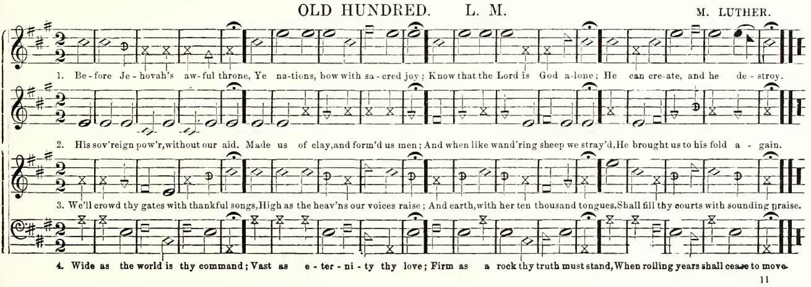
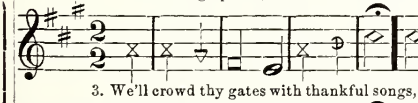
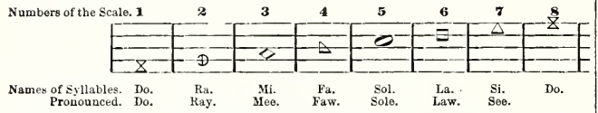

This is a companion appendix to [On Shape Notes](/notes/on-shape-notes/). It follows one small quotation through the machinery that puts it between paragraphs. The musical choices and the programming choices belong together: deciding what a note means comes before deciding how imperfectly to draw it.

The implementation described here is the one inspected on 17 October 2026. A later section proposes a way to leave some pauses empty; that extension has not been implemented.

## Begin with a page, a part, and a verse

The starting point is a particular printed arrangement, rather than an abstract tune. In the 1919 printing of M. L. Swan's *The New Harp of Columbia*, page 11 contains Old Hundred in four parts. The example used here takes the tenor's opening line, with the words of verse 3: *We'll crowd thy gates with thankful songs*.



The page matters because a tune name alone does not specify its arrangement, rhythm, voice, or words. Even a single arrangement can furnish several quotations: the same tenor notes sung to a different verse are another textual encounter. The catalog therefore distinguishes a **phrase**, including its chosen words, from a **passage**, identifying the arrangement, voice, and location shared by those notes.

Here is the tenor detail used for transcription:



*Source for both images: M. L. Swan, The New Harp of Columbia (Nashville: Publishing House of the M. E. Church, South, 1919), 11. Public domain.*

The current process is manual transcription into a YAML catalog. It does not recognize notes from the scan automatically. Each entry records pitches, written durations, syllables, the source's notation system, and enough bibliographic detail to find the passage again. Editorial notes identify departures or omissions. For Old Hundred, these include the undrawn hold over the final note and the tenor's sounding an octave below the written pitches.

A shortened example shows the relationship between the fields:

```yaml
id: old-hundred-tenor
passageId: new-harp-1919-old-hundred-tenor-line-1
system: swan-seven
key: { tonic: A, mode: major }
meter: '2/2'
notes:
  - { pitch: A4, dur: half, syl: "We'll", sourceHead: swan-do }
  - { pitch: A4, dur: half, syl: crowd, sourceHead: swan-do }
  # The remaining six notes follow in the complete record.
source:
  tunebook: The New Harp of Columbia
  year: 1919
  page: 11
  tune: Old Hundred
  voice: tenor
  verse: 3
  locator: first line
```

A catalog entry is a small editorial edition. A questionable attribution can be retained as an attribution *as printed*, without treating it as the last word in music history.

## Shapes carry musical information

Two profiles are currently supported: four-shape fasola notation and Swan's seven-shape notation. Their major-scale syllables are respectively fa–sol–la–fa–sol–la–mi and do–ra–mi–fa–sol–la–si. The seven-shape profile follows Swan's particular system; it is not a generic profile for every seven-shape book.



*Source: Swan, The New Harp of Columbia (1919), 4. Public domain.*

The resolver uses the written pitch letter and the key to find a scale degree, then looks up its syllable and head in the selected profile. Its minor-key convention works from the relative major. Accidentals remain in the pitch record, but do not independently choose a different head: the head calculation follows the letter's place in that profile.

This is a bounded rule, not a claim to interpret every historical notation practice. When a record supplies `sourceHead`, the computed head must agree with the transcribed one. A disagreement stops resolution and calls attention to the transcription, key, or profile. Agreement is a useful consistency check; it cannot prove that the scan was read correctly, especially if the pitch and head were both mistranscribed consistently.

Syllables are explicit too. A trailing hyphen joins syllables into a word; a note continuing the preceding syllable is marked as such. Beams, ties, and slurs are recorded as spans between numbered events. Written durations support dots and tuplets. These details distinguish a sung line from a row of decorative symbols.

## What survives without the staff

The divider preserves the order of events, source-specific heads, melodic contour, and a visual distinction between durations. It omits the staff, clef, and key signature, and quotes only one voice. It does not display the complete pitch spelling or the other parts. The full score remains necessary for musical reading.

Vertical placement follows **diatonic steps**, rather than semitone distances. Internally, a pitch gets the coordinate `7 × octave + letterIndex`, where C has index zero. Adjacent letter names are adjacent steps; C and C-sharp share a height. At the default SVG size, each step moves the notehead by 3.4 units. Higher notes sit higher on the page.

The horizontal rule passes through the midpoint of the phrase's highest and lowest noteheads. It is a compositional axis, not a restored staff line or a pitch reference.

Horizontal spacing follows duration through a deliberately compressed function:

```text
advance(q) = 6.5 + 4.6 × sqrt(q)
```

Here `q` is duration measured in quarter notes, including dots and tuplets. A quarter note advances 11.1 units; a half note about 13.0; a whole note 15.7. Longer values receive more room, but a whole note does not occupy four times a quarter note's space. This is typographic spacing, not a proportional timeline.

The renderer attempts to fit the phrase into a nominal width of 150 units, while protecting a minimum advance of 11 units between events. That minimum can take precedence over the nominal width. There is also a hard limit of sixteen notes and rests. These constraints encourage short quotations; this renderer is not a substitute for an engraving system.

Stem directions follow the contour's midpoint. Beamed groups share a direction, with a bounded beam slope and a minimum stem length. Open heads have actual interior cutouts. Rests, dots, flags, beams, ties, and slurs have drawing routines, although the smaller rest symbols are simplified at this scale. A convincing silhouette should not be mistaken for a facsimile of the source.

## Drawing ink that holds still

A perfectly geometric note can look conspicuously new beside the printed page that supplied it. The renderer introduces restrained irregularity at two levels: the vector geometry and an SVG filter.

First it builds a clean outline for each head. Swan's do, for example, has an hourglass outline and two separate interior spaces. His la has heavier top and bottom edges than side edges. Those proportions belong to the head design before any noise is added. Randomness alone cannot produce convincing type.

Short polygon outlines have their edges subdivided. Each resulting vertex is displaced slightly toward or away from the head's center. A corner-cutting pass then softens the contour. The outer perturbation is at most 0.16 SVG units; interior counters use smaller perturbations. These are small deviations beside an approximately 8.4-by-6.8-unit head.

Each event receives a repeatable pseudo-random sequence. An FNV-1a hash of its phrase identifier and event index seeds a Mulberry32 generator. The sequence controls outline variation, fill opacity between 0.86 and 0.98 before output rounding, stem width between 0.7 and 0.92 units, and a small lean on unbeamed stems. Changing a phrase's identifier therefore changes its particular irregularities.

Second, the SVG filter adds fine surface variation:

| Stage | Current setting | Purpose |
|---|---|---|
| Edge noise | Fractal noise, frequency 0.85, two octaves | Supplies a displacement field |
| Displacement | Scale 0.55, red and green channels | Slightly disturbs the rendered edge |
| Grain | Fractal noise, frequency 2.2, one octave | Supplies a finer mask |
| Alpha mask | Alpha derived from `5.3 − 7 × red`, clamped | Removes small portions of ink |
| Composite | Displaced image inside the mask | Combines contour and dropout |

The filter's seed also comes from the phrase identifier. Given the same resolved phrase, renderer version, and options, the generated SVG is repeatable. Browsers can still rasterize its edges and filters differently; identical markup is a narrower promise than identical pixels everywhere.

This is a designed evocation of uneven ink and worn edges. It is not a physical simulation of a press, nor evidence about the original printer's technique. Its small irregularities keep the shapes from feeling mechanically pristine without making damage the subject of the page.

## Two kinds of chance

The ink and the selection method use randomness for different purposes. Ink variation is seeded so that an existing phrase keeps its appearance. Phrase selection uses Node's `crypto.randomInt` to choose uniformly from the currently eligible entries, then saves that decision in an assignment ledger.

A draw belongs to an essay and a named slot. The method is:

1. Read and validate the catalog, essays, and ledger.
2. Return the saved assignment if this slot already has one.
3. Exclude demonstration fixtures and phrases already reserved by assignments or recognized manual uses.
4. Optionally exclude any entry sharing a reserved `passageId`.
5. Choose one eligible phrase uniformly and save its identifier, essay, slot, and timestamp.
6. Return the snippet for the author to place in the essay.

Draft assignments reserve phrases too, including assignments not yet placed. The ledger is locked during updates and replaced through a temporary file, so overlapping commands do not casually overwrite one another. When the pool is exhausted, the command stops rather than silently starting another cycle. Running a draw again for an assigned slot keeps the original result.

The optional distinct-passage rule prevents another verse of the same notated passage from being drawn. It does not deduplicate every occurrence of the same tune title across books or arrangements. Uniform selection is over eligible **phrase records**, so a tune with several eligible records has more chances to appear than a tune with one.

The authoring commands are available through `phrase:draw`, `phrase:list`, `phrase:check`, and `phrase:release`. Release is an explicit editorial action. A saved assignment does not make the interpretation inevitable; it makes the selection stable enough to examine.

## A method for writing after the draw

The code supplies a phrase, not a reading of it. My proposed writing practice is to draw at a real turn in an unfinished argument, inspect the source and surrounding words, and ask what the quotation changes. It might introduce a promise I cannot make, an assurance I distrust, or a lament my paragraph has hurried past.

The catalog is already a selection. So are its phrase boundaries and verses. There is no unmediated oracle here. The useful discipline is to notice the editorial choices that chance makes visible, including a decision to decline the result. I would keep a brief private record of the draw, the reason for any refusal, and what happened to the following paragraph.

The musical source remains important after selection. Reading the rest of the hymn can undo the meaning that a convenient excerpt seemed to offer.

## Leaving a pause empty: a proposed extension

At present, authors can simply leave a break without a divider. The draw command itself has no saved silence outcome.

A possible extension would distinguish breaks deliberately protected from music from breaks eligible for a draw. Protected breaks would remain empty. An eligible break would first draw between silence and music using a declared probability `p` for silence; only a musical outcome would proceed to the available phrase pool. Both outcomes would be saved once.

This separates the frequency of silence from catalog size. Adding ten hymns would not accidentally make silence ten times less likely. No particular value of `p` has been chosen. An exhausted musical pool should remain an explicit exhaustion result, rather than masquerading as a chance decision to be silent.

Such a ledger would need a new schema, validation, authoring output, and tests. This appendix describes the proposal so that its intention is visible; it does not claim the feature exists. More fundamentally, a random empty result cannot decide which absences deserve to remain unfilled. That judgment belongs to the writer before a break enters the draw.

## Reading, motion, and paper

The phrase is rendered to SVG during the build. Words and source sit in native HTML disclosure elements, usable by keyboard and touch without JavaScript. Mouse preview and scroll animation are enhancements. The visible SVG is hidden from screen readers; the disclosure supplies a textual label, lyrics, source, and the sequence of musical syllables or rests. It is not a complete nonvisual transcription of pitch and rhythm.

Each event fades in over 480 milliseconds, staggered by 35 milliseconds. This is not playback: the animation follows event order, rather than musical durations or tempo. Dividers already visible at initialization remain visible. Reduced-motion preferences disable the reveal.

For print, the filter is removed and the notes remain visible. The underlying vector irregularity remains. The disclosed words and source panel are hidden, so an author who wants the quotation documented on paper must supply an ordinary footnote. The appendix keeps its bibliographic identification in visible prose for the same reason.

## What another scan could contribute

The most useful additions would be a clear rudiments page, whole pages containing contrasting open and filled heads, and passages with ties, slurs, dotted notes, or unusual accidentals. A title page would establish the printing more securely. Full-page scans preserve clefs, signatures, part labels, and context that a close crop can lose; a detail is useful alongside them.

These would support further comparison and transcription. They would not automatically enter the catalog. A new quotation still needs its voice, verse, boundaries, and source checked by a person.

## Five Southern Harmony comparisons

Five supplied screenshots give the four-shape side of the comparison concrete musical examples. The observations below concern the visible images, identified by the author as *Southern Harmony*. They do not establish the edition: that requires checking the PDF's title page. The visible page numbers are printed numbers, not PDF viewer positions.

| Tune | Visible page | What to examine |
|---|---|---|
| Complainer | 18 | Open and filled heads in one setting, with printed text continuing into separately set verses |
| Green Fields | 71 | Repeated rhythmic figures and a second setting to compare with Columbia's Greenfields |
| Mear | Not visible in this crop | Long, mostly open note values; the interior spaces must survive reduction |
| Resignation | 38 | Curved connections over groups of notes and changing durations; each arc needs musical identification before transcription |
| Holy Manna | 103 | A denser succession of shorter notes, repeated figures, and holds; useful for judging how much fits in a small ornament |

For the ink treatment, Mear is especially revealing. Empty interiors have to stay open when the drawing is reduced. A triangle that fills in under the grain filter has lost musical information, however persuasive its texture. Complainer and Holy Manna make the complementary demand: filled heads should remain distinct, and stems should remain attached. Comparing these pages suggests a practical hierarchy for visual review: identify the shape, distinguish the duration, follow the contour, then judge the surface texture.

Resignation asks for a different kind of attention. A curved mark cannot be transcribed merely as an attractive arc. Its endpoints, pitches, and relation to the words determine whether it is a tie or a slur. The renderer supports both kinds of span, but the screenshot alone should not become permission to guess at a blurred endpoint.

Green Fields also complicates the idea of quotation. The catalog already contains Greenfields from Columbia. A matching title is an invitation to compare the two sources, not evidence that their notes, part-writing, or verse placement are interchangeable. The comparison should begin with the full arrangements and only then choose a short voice-specific passage from each.

These examples have textual consequences as well. Mear opens with a question about divine rejection; Resignation begins with an assurance of provision; Complainer gives voice to religious inadequacy. That variety is worth retaining without turning the tunes into fixed mood labels. The rest of a hymn may resist the meaning that an isolated line acquires between two paragraphs.

The supplied images are suitable for identifying comparison cases. Their small, softened notation makes the original PDF preferable for checking individual pitches, dots, and span endpoints. No new phrase transcription or claim of completed renderer verification follows from these observations alone.

For readers who want to follow the implementation, the principal files are [the catalog](https://github.com/joeloetting/compost-et-coagula/blob/master/src/data/shapeNotes/phrases.yaml), [musical resolution](https://github.com/joeloetting/compost-et-coagula/blob/master/src/lib/shapeNotes/notation.ts), [SVG rendering](https://github.com/joeloetting/compost-et-coagula/blob/master/src/lib/shapeNotes/render.ts), [phrase assignment](https://github.com/joeloetting/compost-et-coagula/blob/master/src/lib/shapeNotes/assignments.ts), and [the page component](https://github.com/joeloetting/compost-et-coagula/blob/master/src/components/ShapeNoteDivider.astro). These links follow the evolving source; the date above identifies when this account was checked.
